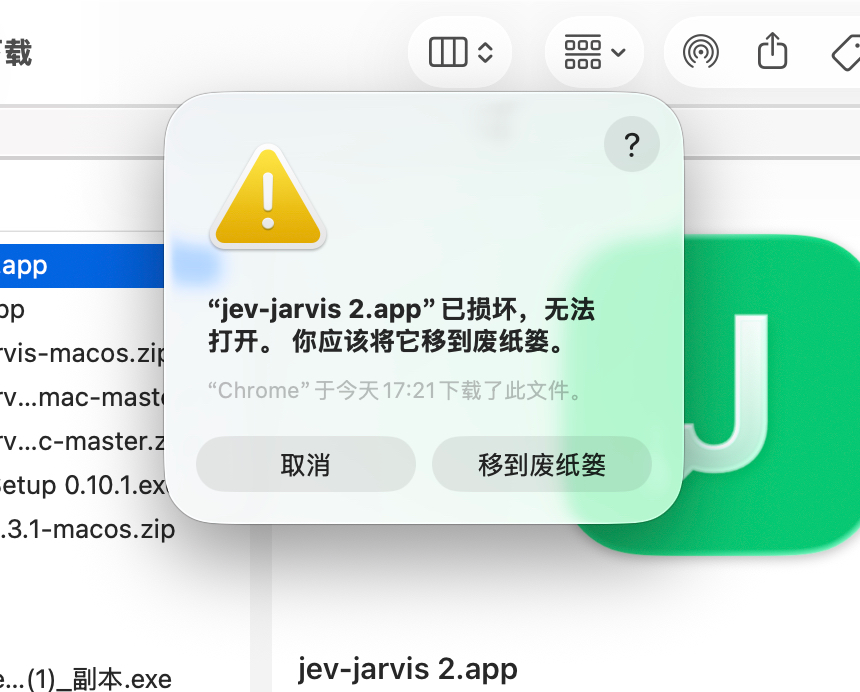

# jev-chat-jarvis（macOS）

聊天应用弹出一条消息 → 悬浮窗立刻告诉你**这句话的真实意图**、**风险几级**、**该怎么回**。

**纯只读、无侵入**——不注入、不 hook、不解密数据库，只是「看屏幕 + 本地模型判断」。


## 反馈与帮助

**先自查：[常见问题解答（FAQ）](docs/FAQ.md)——配置文件、日志、模型路径、安装报错、旧版空白面板速查。** 数据流向与隐私见 [PRIVACY.md](PRIVACY.md)；反馈与合作请开 GitHub issue。

## 平台支持

| 平台 | 状态 | 采集方式 | 需要的权限 | 备注 |
|---|---|---|---|---|
| 支持的聊天工具（macOS，截图识别路径） | ✅ 浅色、深色主窗口有实测 | 窗口截图 + Apple Vision OCR | 屏幕录制；AX 填入另需辅助功能 | 自动与手动校准共用气泡分类；已验证布局见「已知限制」 |
| 支持的聊天工具（macOS） | ✅ | 系统文本接口直读（无截图） | 辅助功能（读 + 填入） | 不截图、不 OCR；消息方向按界面样式判定 |

悬浮窗跟随当前在前台的那个应用，共用同一套判断、生成与悬浮窗。

## 它能做什么

- **意图 + 风险**：8 类意图零样本 **86.4%**（22 条回归口径），风险 0–9 分级 + 行动建议，本地模型一次前向出全分布
- **候选回复**：内置 14 种话术并发生成（含恋爱向「狗头军师」三件套：稳健 / 会撩 / 抽离；每种话术候选数 1—5 条可配置，默认 2 条）→ 先上屏 → 本地模型排序后原位重排；换话术立刻按当前消息重新生成
- **窗口层级**：状态栏菜单「固定在最前面」可即时切换悬浮窗是否盖在其他窗口上，默认开启；关闭后其他窗口可以盖住面板
- **快**：消息一出现判断 + 生成同时起跑，M1 Pro 出意图 ~1.5 s、出候选 ~1.5–2 s（端到端为机制推算口径，以日志实测为准）
- **正文与引用**（截图识别路径）：自动与手动校准都按气泡和相对位置区分正文、昵称及固定公告；引用作为所属消息的背景，避免当成另一条待回复消息
- **YOLO 检测框**（可选，`JEV_BOXES=1` 启动即开、菜单栏可切）：显示消息归属、引用状态和 OCR 置信度；输入框实线/虚线及消息配色见「输入区检测框与填入」

## 面板读法

面板使用 macOS 原生浅色磨砂材质：顶部是当前聊天、分析状态、正在处理的消息与上下文；中间依次显示意图、识别率、风险等级和行动建议；底部按话术分组展示候选回复。当前风险圆点会轻微呼吸提示。每条候选左侧是本地排序概率，右侧仍只有「复制」和「填入」；候选行会随完整文字自动增高，不截断内容，发送始终由用户在聊天应用里手动完成。

面板默认开三组话术：**高情商话术、贴吧老哥 v1.0、阴阳怪气**，每个下拉可换成其余语气或「不用」；「不用」的话术槽只保留一行下拉选择，不生成也不占候选行；开启或关闭话术只改变面板高度，不改变判断与轮询流程。黄色窗口按钮收起到聊天名与状态，红色窗口按钮退出。

聊天标题支持单字和较短的联系人名称；识别到聊天标题变化时，即使最后一条消息相同，也会重新分析。

## 消息与引用识别（截图识别路径）

截图识别路径的自动识别和手动校准共用同一套分类规则：先由 Apple Vision 读取文字，再根据截图中的气泡表面、边界和左右对齐关系确定消息归属。自动模式也使用像素气泡分类；相比原先主要按文字位置分组，昵称、固定公告和引用不再直接混入正文。只有确认来自对方的正文才触发判断与候选生成。

- **昵称与正文**：气泡外可关联的昵称只作发言人标签；同一气泡内的多行文字合并，相邻独立气泡分开。短句、数字及正文中的姓名不会因为字数少或像昵称而删除。
- **固定公告**：根据聊天区顶部横条和分隔线排除固定群公告；正常消息中出现「公告」「发送」等字样仍按正文处理。
- **引用**：边界可确认的内嵌引用、正文下方带竖线的引用归属于当前消息。模型上下文标记为「引用背景（作者，不是新发言）」；作者无法确认时标为「作者未知」。例如乙回复「可以」、引用甲的「明天能来开会吗」，待回复正文是「可以」，甲的问题是背景。只有引用、没有当前正文时，不独立触发回复。
- **正文与引用待区分**：已经确认是对方消息，但 OCR 把正文与引用合在一起、无法可靠拆分时，保留可读原文并显示该标记，仍可生成候选；不猜拆分或引用作者。
- **归属未确认**：无法确定文字属于哪一方时，可在检测框和校准预览中显示，但不进入回复目标、模型上下文或聊天历史。这与「正文与引用待区分」含义不同。

自动模式用识别到的输入区左边界辅助定位聊天区，可处理本次验证的宽侧栏布局；这不代表所有分栏宽度、全屏和独立聊天窗都已适配。消息规则的实机验证范围见「已知限制」。

浅色、深色主题的脱敏实机效果截图及对应期望结果见 [识别实机验证](docs/recognition-validation.md)。

## 手动校准消息区域

联系人列表可拖动时，固定比例的自动区域可能漏消息或读到列表摘要。提供可选手动模式（v0.6.0 起可用）：

1. 调整好聊天窗口、联系人分栏和输入区，点击悬浮窗右上角齿轮左侧的 **校准图标**（四角取景框）；菜单栏 **J → 校准区域…** 也可进入同一个界面。
2. 在同一张截图上编辑两个选区：**消息识别区域（绿框）** 包含双方头像、昵称和气泡；**输入区域（蓝框）** 包含完整文字编辑区，排除底部工具栏和发送按钮。顶部切换当前编辑区域，两框始终同时显示；拖动四条边可微调。
3. 点击 **预览识别**，同时检查消息识别和输入区位置；**「确认并启用」在预览通过前保持禁用**，通过后 **一次保存并启用两个区域**。中途取消不会保存任一区域，也不会覆盖原校准。
4. 菜单栏 **恢复自动识别区域** 可退出手动校准、回到自动识别。校准界面共用主面板/模型设置的磨砂背景、圆角卡片、配色和按钮样式。

消息区和输入区分别保存到现有用户 env 的 `JEV_MESSAGE_REGION`、`JEV_INPUT_REGION`，值是窗口宽高及选区 x/y/宽/高（窗口点坐标），保留其他配置和注释、文件权限 600。每次启动在同一界面重新确认保存的两个选区；窗口整体移动无需重画，窗口尺寸或窗口身份改变后暂停并要求重新校准。**拖动内部列表、改变输入区高度、切换带公告的聊天后，请主动重新校准**；当前不保证自动识别这些内部布局变化。选区上方独立读取聊天标题，标题为空时不分析。两个选区各自有最小尺寸：消息区至少 80×60 点才允许预览与保存；输入区只要求完整框住编辑区（至少 40×24 点），输入栏较矮的应用（例如约 40 点高的 WhatsApp）也能完成校准。

校准模式沿用上面的正文、昵称、公告和引用规则，左右归属基于选区内气泡位置和同侧对齐。对紧凑、均匀且原 OCR 没有文字的灰色气泡，按气泡大小放大到至少 192 像素高，进行一次局部 Apple Vision Accurate 英文识别，仅补充置信度至少 0.5 的纯数字；已有文字不重复处理，不猜数字序列，也不把 I 等字母替换为数字。图片、复杂主题和特殊昵称仍可能识别不全；这不是通用视觉理解模型。

**两个区域尚未确认时不允许填入，可使用复制。** 校准模式下填入同样优先辅助功能（AX）写入：输入控件可定位时直接写入并读回确认，草稿在其后追加；定位不到时回退校准的输入区框，复制到剪贴板、由用户自行粘贴（见 #139）。AX 定位在读屏期间持续尝试（成功 1 秒/失败 3 秒刷新），节流期内沿用上次结果。不会清空草稿或发送消息。手动坐标不走自动输入区定位；用户改变内部布局后必须重新校准，不能保证自动发现分栏/输入区高度变化。手动模式每次重新 OCR，不复用空帧的旧消息，不新增哈希；因此性能与自动模式不同。

校准功能的离线回归覆盖短句、相邻气泡、多行文本、宽列表下的左右归属、深色合成气泡、选区边界、配置权限及空帧不复用。原生窗口已验证消息区及输入区预览/保存/取消与恢复入口；截图复测覆盖宽窄列表和私聊，单独数字 1/2/3/4 在原始与 1 倍采样下均保留。本次识别修复另用同批真实截图回放自动、手动两条识别路径，并在真实应用中验证读屏、判断、候选上屏和排序；未执行填入或发送。回放覆盖不等于所有模式与主题的实机全流程验收，具体范围见「已知限制」。

## 用法

**仅支持 Apple Silicon（M 系列）Mac**，macOS 13+。不支持 Intel Mac，也不要通过 Rosetta 运行（本地判断模型依赖的 torch 没有 Intel 版本，#19）；启动时会检测并以中文提示原因。

**用 Homebrew 装（推荐，免"右键打开"）**：

```bash
brew tap jev-chat/tap
brew install --cask jev-chat/tap/jev-jarvis
```

Homebrew 下载的文件不带 quarantine 属性，装完直接打开；卸载用 `brew uninstall --cask jev-jarvis`。

**只想用**：[Releases](https://github.com/jev-chat/jev-chat-jarvis-mac/releases/latest/download/jev-jarvis-macos-latest.zip) 下载 `.app`，解压拖进「应用程序」，**第一次右键 → 打开**（没做公证，双击会被 Gatekeeper 拦）。



弹窗若显示「**已损坏，无法打开，你应该将它移到废纸篓**」（浏览器下载的 zip 常见，右键打开也绕不过），别删——在终端清掉隔离属性即可：

```bash
sudo xattr -r -d com.apple.quarantine /Applications/jev-jarvis.app
```

`.app` 若改过名（如「jev-jarvis 2.app」），把命令里的目录名换成实际路径。

首次启动按提示授予「屏幕录制」权限（系统设置 › 隐私与安全性 › 录屏与系统录音，给 **jev-jarvis** 打开），**退出重开**生效；「填入」另需「辅助功能」权限，第一次点会弹系统授权框。v0.3.1 及更早的旧版本还需把 **python3.12** 那条一并打开。只用文本接口路径的应用不需要屏幕录制权限，辅助功能一项即可。

缺少可用的 uv 时，两种启动入口都先完整下载并执行官方安装脚本（下载含超时和重试），失败后尝试已有的 Homebrew。失败提示区分网络、证书、磁盘和安装器错误，详细输出见 `~/Library/Logs/jev-jarvis.log`。官方脚本安装到 `~/.local/bin`，不修改 shell 配置。

**从源码跑**（聊天应用在运行、终端已授予屏幕录制）：`./start.command`。分层自测：

```bash
uv run python src/perception.py                  # 感知层：识别到的消息 + 耗时
uv run python src/judge.py "这个需求你今天跟一下"  # 单条消息出判断
uv run python src/judge_zh_test.py               # 22 条中文意图回归
uv run python src/generate.py --check            # 生成层凭据解析
uv run python -B -m unittest discover -s tests   # 发出消息/异步结果回归（合成 OCR，不读屏）
uv run python probe/bootstrap_regression.py      # 两种启动入口的离线回归；不联网、不实际安装
```

## 配置

两层、两个 key、**都可以不填**：判断层不填时首次启动会引导选择——配置 key 在线判断，或下载离线模型（约 3.8 GB）；也可以稍后再说，面板会持续提示。生成层打包版内置共享 key，不配也能出候选，数据流向见 [PRIVACY.md](PRIVACY.md)。全部配置在一个 env 文件（**不提供第二种格式**）：

### 可视化配置（#18）

点击悬浮窗右上角 **齿轮图标（模型设置）**，或菜单栏 **J → 模型设置…**，可编辑 Jev、OpenAI 兼容、Anthropic 兼容三组密钥、服务地址与模型。设置窗口支持 ⌘C/⌘V/⌘X/⌘A（剪切、复制、粘贴、全选）。
设置窗口显示在悬浮窗上方，不会被面板遮挡。各页统一使用底部「保存配置」：**模型配置保存后必须退出并重新打开应用**；「会话记录与背景」页的修改保存后立即生效。

- 窗口编辑 `$XDG_CONFIG_HOME/jev-jarvis/env`（未设置时为 `~/.config/jev-jarvis/env`），显示具体路径。只修改所编辑服务的字段，保留其他配置、注释和未识别行，文件权限设为 `600`。文件被其他程序修改时拒绝覆盖，需重新打开窗口。
- 填好地址与密钥，点击「获取模型列表」从该服务的 `/models` 接口动态获取，再下拉选择；不内置模型清单。Jev 按官方 `models[].name` 读取（当前列表为别名，未列出的版本号仍可手填）；OpenAI/Anthropic 按 `data[].id` 读取。接口不支持、失败或返回空列表时明确提示，仍可手填，不自动换模型或服务。空下拉显示「暂无」（仅作提示，不作为模型保存或调用），仍可手填；底部动态提示以蓝色显示进行状态、绿色显示成功、红色显示错误。列表可见不代表一定有生成权限，选定后再测试。
- 「测试连接」使用窗口内**尚未保存**的地址、密钥和模型发起实际调用，仅发送固定问候语，不读取聊天内容；可能产生少量服务费用。生成层必须返回非空文字才算成功，不能用 `--check` 的配置解析成功代替连接成功。
- 密钥掩码显示；窗口仅读取所编辑文件中的值，不把环境变量、项目 `.env` 或内置共享密钥复制进用户文件。各配置页顶部突出显示本次启动正在使用自己的密钥、内置共享密钥或本地判断，以及实际来源；生成页同时标明当前启用的服务，优先级保留在窗口下方。
- 环境变量优先于用户 env，用户 env 优先于项目 `.env`；生成层 OpenAI 组优先于 Anthropic 组，均未配置才使用内置共享密钥。清空当前文件的密钥不会禁用其他来源中的密钥。由终端或启动器导出的值也显示为「环境变量」。
- API 格式由密钥组决定：`OPENAI_*` 使用 OpenAI 格式，`ANTHROPIC_*` 使用 Anthropic 格式；自定义地址不需要包含服务名称。Ollama 可填 `http://localhost:11434/v1`、密钥 `ollama`，模型从本地服务获取或手填。Jev 地址带不带末尾 `/v1` 都行，与手动配置共用同一条拼接规则。
- 钥匙串：不新增钥匙串读写。如果原 env 用 `$(security find-generic-password …)` 等 shell 表达式提供密钥，窗口不执行表达式、不展示其内容，未输入新密钥时保留原行；仍由已有启动器执行。要在窗口测试该服务，需明确输入密钥；保存将用输入值替换原表达式。外部注入的密钥继续遵循环境变量优先级。
- `JEV_BOXES`、`JEV_TONES`、`OPENAI_EXTRA_BODY` 暂仍通过 env 配置，保存窗口不会改动它们。OpenAI 连接测试沿用当前启动的 `OPENAI_EXTRA_BODY`；完整话术管理等留待后续扩展。
- 生成设置里的「每种话术候选数」可选 1—5 条，默认 2 条；它作用于 OpenAI/Anthropic 两种生成格式，保存后重启生效，也可用 `JEV_CANDIDATES_PER_TONE` 配置。

也可继续手动编辑：

```bash
mkdir -p ~/.config/jev-jarvis
cat > ~/.config/jev-jarvis/env <<'ENV'
# 判断层（可选）：TypeSafe Jev，不填用本地 decider-2b
export TYPESAFE_API_KEY=""

# 生成层：任意 OpenAI 兼容端点
export OPENAI_API_KEY="sk-你的key"
export OPENAI_BASE_URL="https://api.deepseek.com"
export OPENAI_MODEL="deepseek-chat"
# 端点的思考模式要靠额外字段关时填（Qwen3 这类不关会慢几十倍）
# export OPENAI_EXTRA_BODY='{"enable_thinking":false}'
ENV
chmod 600 ~/.config/jev-jarvis/env
```

- **凭据解析以 key 为准**：提供 key 的来源同时决定端点和模型。实测可用：DeepSeek `deepseek-chat`（最快）；智谱 `glm-4-flash`（换 `ANTHROPIC_API_KEY`/`ANTHROPIC_BASE_URL`/`ANTHROPIC_MODEL`，两组都填 OpenAI 组优先）；本地 Ollama `qwen2.5:7b`（完全不出网）
- **判断层网关**：`TYPESAFE_BASE_URL` 三种填法等价可用——只到主机（`https://api.typesafe.ai`）、带版本段（`…/v1`，自动补动作段，不会出现 `/v1/v1/…`）、或填完整动作路径（填到动作段为止，原样使用、不再拼接）。第三方 TypeSafe 兼容网关填网关地址 + 网关 key，模型名按网关填写（如 Vercel AI Gateway 填 `https://ai-gateway.vercel.sh/v1/evaluate`、模型 `typesafe-ai/jev`；OpenRouter 填 `https://openrouter.ai/api/alpha/decisions`、模型 `typesafe/jev-1.13`，key 用 OpenRouter 的 `sk-or-…`，响应同为 systemone 形状）
- **判断方式选择（`JUDGE_BACKEND`）**：首次启动（未配判断层 key 且离线模型未下载）会弹一次选择，结果写进 env：`cloud`=在线判断（不下载、不加载本地模型）、`local`=离线判断（预热时下载，选过就不再问）、`skip`=稍后再说（不再弹，消息时面板提示）。不写此键时：模型已在本地就照常使用，未下载则**不会自动下载**，面板提示引导。模型设置的「判断 · Jev」页可删除离线模型（显示实际占用）或启用离线判断
- **国内网络加速**：模型已缓存后启动**完全不联网**（直接从本地快照加载，不查新版本）；首次下载时若 huggingface.co 不可达（探测 2.5 秒），自动改用镜像 `hf-mirror.com` 下载并在日志注明。也可在 env 里 `export HF_ENDPOINT="https://hf-mirror.com"` 显式指定任意兼容端点——显式配置优先，不再探测
- **别用 thinking 模型**：思考吃光 `max_tokens`，候选 0 条，面板只报「候选生成失败」——DeepSeek 认准 `deepseek-chat`
- **自定义话术**：env 加一行 `JEV_TONES`（`|` 分隔、每条「名字=说明」，同名覆盖内置，重启生效），如 `摸鱼大师=像资深摸鱼选手，把活推得漂亮又不失礼`。**有质量门槛**：说明至少 10 字，写清「什么语气 + 别变成什么」；太短的（如「夸我」）不会加载，启动日志会写明原因——说明太空模型就没得发挥，候选只会平庸
- 自查凭据（不打印完整 key）：`uv run python src/generate.py --check`、`uv run python src/judge_jev.py`

## 会话历史与背景

在设置的「会话记录与背景」页开启 **记录聊天历史**（默认关闭）。应用只累计实际读到的已发送消息，包含本人和其他成员；每个聊天固定保留最近 **100 条**，不自动翻页、不读取本地聊天数据库。重复读屏按消息序列衔接，相同文字的不同消息可以分别保留；无法可靠衔接时会少记；后续连续读屏确认的新消息作为独立片段保存，模型不会跨未知断层拼接上下文。

截图识别路径读到的引用及引用作者随所属正文保存，不额外占一条历史，也不作为新的待回复发言；固定公告、孤立引用和归属未确认文字不进入历史。正文相同但引用或拆分状态变化时，会更新当前分析。判断、生成与排序使用相同的引用标记；消息正文与送入模型的会话上下文（历史、引用及人工背景）共用 8192 字符预算，过长内容会裁剪，本地保存的历史原文不因此缩短。

「聊天背景」可写相关背景信息，例如「AAA 是群主，BBB 是公司老板」。「保存配置」统一保存这些背景、记录开关及条数。保存后，仍有效的当前目标会重新分析。背景不占消息条数，清空编辑框后保存即可删除。

- **关闭历史**：停止记录和使用已存历史，保留本地数据；当前画面与人工背景仍可辅助推理。
- **管理记录 → 清空所选会话记录／清空全部记录**：立即删除相应已存消息，保留背景；后续有效读屏仍按开关继续记录。
- 设置沿用 env：`JEV_HISTORY=0`（关闭）或 `1`（开启），`JEV_CONTEXT_MESSAGES=20`。非法条数不接受；启动时无效值回退为 20。通过本页保存的值重启后仍可编辑；真正由启动环境变量传入的值优先，对应选项不可编辑，需修改环境变量后重启。

历史和背景保存在 `~/Library/Application Support/jev-jarvis/conversations.json`，源码运行与打包 `.app` 使用同一位置，不随启动时的工作目录变化。

历史和背景仅保存在本机，但推理时会发给当前选择的模型服务及配置的中转；服务地址可在对应模型设置页配置，修改后需重启生效，服务方的留存政策由其决定。应用不增加历史云同步或项目后台存档，详见 [隐私说明](PRIVACY.md)。

## 磁盘占用与清理

| 内容 | 位置 | 大小 | 清理 |
|---|---|---|---|
| 判断层本地模型 `decider-2b`（首次启动引导选择后才下载，判断+排序共用） | `~/.cache/huggingface/hub/models--Mapika--decider-2b` | ~3.8 GB | 模型设置 →「判断 · Jev」页「删除模型…」；或 `rm -rf ~/.cache/huggingface/hub/models--Mapika--decider-2b`；之后走本地判断会重新下载 |
| 会话历史与背景 | `~/Library/Application Support/jev-jarvis/conversations.json`（权限 `600`） | 每会话最多 100 条，背景独立 | 设置 → 会话记录与背景 → 管理记录；背景清空后保存。删除应用不会自动删除此数据文件 |
| Python 运行环境（venv） | `~/Library/Application Support/jev-jarvis/venv` | ~0.7 GB | 删除 .app 不会连带删它，需手动删 |

生成层配 Ollama 的话模型在 Ollama 自己的目录（`~/.ollama`），非本项目下载。

## 已知限制

- 悬浮窗只在目标聊天应用位于前台时显示和分析；切到浏览器等其他应用会立即隐藏并丢弃未完成的旧结果，返回后强制重新读取当前聊天，避免把旧面板误认为正在识别其他应用
- 截图识别路径的收发方向依赖可辨识的气泡及左右对齐；横跨两侧或居中、无法确认归属的文字标为「归属未确认」，**不作为回复目标，也不进入模型上下文和历史**。只有明确识别为「对方」的消息才触发判断与生成，只有自己消息时面板显示「等待可确认的对方消息…」
- **截图识别路径实机验证范围（2026-09-28—29）**：目标应用 4.1.13 版本、macOS 26.6.2，带侧栏的主窗口、普通群聊，窗口 734×599 点（原始回放截图 1468×1198 像素）。浅色主题采集 3 份截图：2 份下方竖线引用布局，各保留 2 条正文和 2 段引用；1 份普通消息布局保留 5 条正文。另补采 1 份标准深色主题截图，保留 4 条正文和 1 段下方引用。4 份截图及录制 OCR 的自动、手动识别回放均通过，覆盖宽侧栏、圆角短气泡、昵称、固定公告和下方引用；样本均来自同一应用版本与窗口尺寸。浅色已验证读屏 → 判断 → 在线候选上屏 → 排序；深色也已验证实机读屏、检测框、在线候选生成与上屏，另有两种识别路径及回复目标/历史的离线回放。全程未执行填入或发送。脱敏效果截图保留拍摄时的内存警告与「排序中」提示，属于既有内存保护和排序流程的运行状态，本 PR 未修改这些机制；候选已上屏，截图不表示本地判断或排序已完成。详见 [样张与验证边界](docs/recognition-validation.md)。
- **主题与布局覆盖有限**：标准深色仅验证上述一组布局，不能代表所有深色样式。低对比度、透明或无气泡背景的自定义主题尚未实测，可能漏读、误判或显示「归属未确认」；手动校准只能调整区域，不能补足缺失的气泡边界。遇到识别异常可先切回标准浅色主题，再检查校准选区。独立聊天窗、全屏、其他应用版本，以及真实内嵌引用、复杂混合引用、无竖线独立引用尚未在本次实机验收中覆盖；已有合成回归不代表这些组合已经实机适配。
- 图片/表情包读不出内容；应用内卡片消息可能被当消息解读；全屏布局下识别可能失效（布局常量待动态化，见 #17）。引用仅在边界可确认时拆分；不保证所有引用样式均可识别
- 应用改版会让布局常量失效（`src/perception.py` 顶部常量需重新校准）；多窗口优先识别主窗口，且只认配置的应用名列表——名字相近的兄弟应用不参与窗口选择
- 本地判断模型首次下载时，悬浮窗状态行显示模型权重的大致下载进度和体积（如「下载判断模型 34% · 1.2/3.8 GB」，以实际下载文件为准；进度约每半秒刷新，分块处理时可能跳升）；完成后进入加载/预热，再恢复消息状态。已有缓存时不显示下载进度；Jev 不可用转本地时同样适用。
- 启动后第一条判断慢是正常现象（本地模型预热）；不对劲先看日志（分阶段耗时、**不含消息正文**，可放心贴 issue）：`tail -40 ~/Library/Logs/jev-jarvis.log`
- 本地判断模型首次加载（含下载）期间面板状态行显示「判断模型加载中…」；加载失败会红字提示。离线模型未下载时不会自动下载，面板与预热提示会引导选择（配 key 走云端，或模型设置里启用离线判断）。内存不足（总内存 < 12GB，或系统内存压力已在警告档）时**不加载本地模型**，每条消息的面板提示会引导改配 `TYPESAFE_API_KEY` 走云端判断——这是为了防止 #37 那种加载把系统推入内存高压、进程被系统直接终止的情况
- 文本接口路径：只支持独立聊天窗口，紧凑模式（效率模式）的迷你聊天窗不支持；同时开多个聊天窗口时只分析有焦点的那个
- 文本接口路径：图片、表情包、文件等无文字消息读不出内容；引用回复按普通文本处理
- 应用改版若变更界面元素名，感知层顶部常量需同步（probe 脚本可直接查看当前真实取值）

## 输入区检测框与填入

菜单栏「YOLO 检测框」同时显示消息框和输入目标，约每秒刷新。检测框只是识别结果的可视化，不参与消息分类，也不会因为开启检测框而改变识别结果。

| 框线或标签 | 含义 |
|---|---|
| 蓝色实线输入框 | 辅助功能（AX）定位到的输入控件 |
| 橙色虚线输入框 | 截图边界推测或手动校准的输入区；不代表已经取得可写控件 |
| 绿色 / 灰蓝色消息框 | 普通对方消息 / 自己的消息 |
| 琥珀色消息框 +「归属未确认」 | 仅展示，不进入回复目标、模型上下文或历史 |
|「引用背景」/「正文与引用待区分」 | 已分离的附属引用 / 保留原文、尚未可靠拆分；主框覆盖所属消息及已关联引用 |

已分析的当前对方消息会按风险改为绿、琥珀或红色，并附意图与风险值，因此请结合标签区分风险提示和归属未确认。标签中的 OCR 置信度表示文字识别置信度，不是消息归属或 AI 判断的正确率。无法定位输入区时显示原因。

聊天识别会在同一张截图上检测输入区边界，并将输入区排除在消息、上下文和画面变化判断之外；视觉边界不可用时尝试辅助功能定位，仍无法确认则暂停分析。输入草稿不会作为待回复消息。自动模式还使用输入区左边界辅助排除侧栏；布局变化后若仍漏读或混入列表内容，可使用手动校准，不能据此保证 #17 涉及的所有布局都已适配。

悬浮窗跟随 macOS「降低透明度」设置：关闭时保留原版磨砂；开启时使用浅灰绿底、白色卡片与灰绿边线，增强区域区分。切换设置后自动更新，无需重启。

顶部消息区将昵称与正文分开，正文默认显示两行；长消息可点击「展开」查看，超长内容在区域内滚动。「收起」恢复两行，展开操作不会重新请求 AI。

「填入」优先通过辅助功能接口写入并读回确认。目标应用不提供输入控件时，显式点击「填入」会把候选复制到剪贴板并提示自行粘贴——⌘V 由用户按下，工具不模拟任何按键（合成输入事件会被部分应用的账号风控识别，曾导致账号被强制登出，见 #139）。不会自动按发送键；换行和制表符转换为空格（辅助功能写入路径）。

辅助功能路径读到已有草稿时在其后追加；窗口、焦点或会话变化时写入被拒绝并提示，不自动重试。剪贴板兜底会覆盖用户当前剪贴板内容（仅在显式点击「填入」时发生）。

## 下一步（按优先级）

1. **攒标注数据**：把误判的（尤其「催进度 vs 问进度」）记下来，微调冲 95%+
2. **区分聊天消息和分享的文章卡片**：保守过滤，风险是误杀正常消息

## 开发者

- **贡献前必读**：[CONTRIBUTING.md](CONTRIBUTING.md)——动代码前先在 issue 认领（评论 + assignee），分层自测改哪层跑哪层
- 配置界面自测：`uv run python -B -m unittest discover -s tests`；macOS 原生窗口与按钮流程：`uv run python -B probe/settings_smoke.py`（临时配置 + 本地测试服务，不使用个人密钥）。
- 打包 `./packaging/build_app.sh`；发版 `./packaging/release.sh --publish`（干净 worktree 构建 + 解压回验 + gh release）。版本号只有 `pyproject.toml` 一处；有开发者证书可加 `--sign "Developer ID Application: ..."`
- 架构一句话：截图型聊天应用在前台时，通过带超时的 `screencapture` 子进程抓其窗口 → Vision OCR（只扫聊天区）；文本接口型聊天应用在前台时，直读其界面文本 → 同一条管线：本地 decider-2b 出意图/风险 → LLM 并发出候选 → 本地排序 → 悬浮窗 NSPanel。底层仍按窗口 ID 抓取而不是全屏截图，悬浮窗不污染 OCR

## 版权与许可

Copyright © 2026 eatmoreduck 与 jev-chat 贡献者。代码以 MIT 协议开源，另见 [NOTICE](NOTICE)。

- **可以商用**：个人和公司都可以使用、修改、再分发，或集成进自己的产品，不需要付费或事先授权。
- **必须注明出处**：分发或商用时保留 `LICENSE` 与 `NOTICE`，并在产品「关于」页、说明文档或发布页写明来源。推荐写法：基于 Jev 聊天助手（https://github.com/jev-chat/jev-chat-jarvis-mac）二次开发。
- **不要用**「Jev 聊天助手」「jev-chat」名称或 jev-jarvis.com 域名暗示由原作者出品或背书。
- **免责声明**：本项目只处理你自己设备上、你自己有权查看的聊天，不注入、不 hook、不解密数据库、不自动发送任何消息。请遵守所用软件的许可协议与当地法律法规，作者不对使用后果负责。

## 交流反馈

反馈、建议与合作请开 [GitHub issue](https://github.com/jev-chat/jev-chat-jarvis-mac/issues)；数据流向与隐私见 [PRIVACY.md](PRIVACY.md)。

也欢迎扫码关注公众号，追更新、唠嗑：


**隐私与数据流向**详见 [PRIVACY.md](PRIVACY.md)：聊天内容只发给模型服务商——推荐自配 API key 或本地 Ollama；内置免费通道经作者中转，承诺与提醒见该页。
